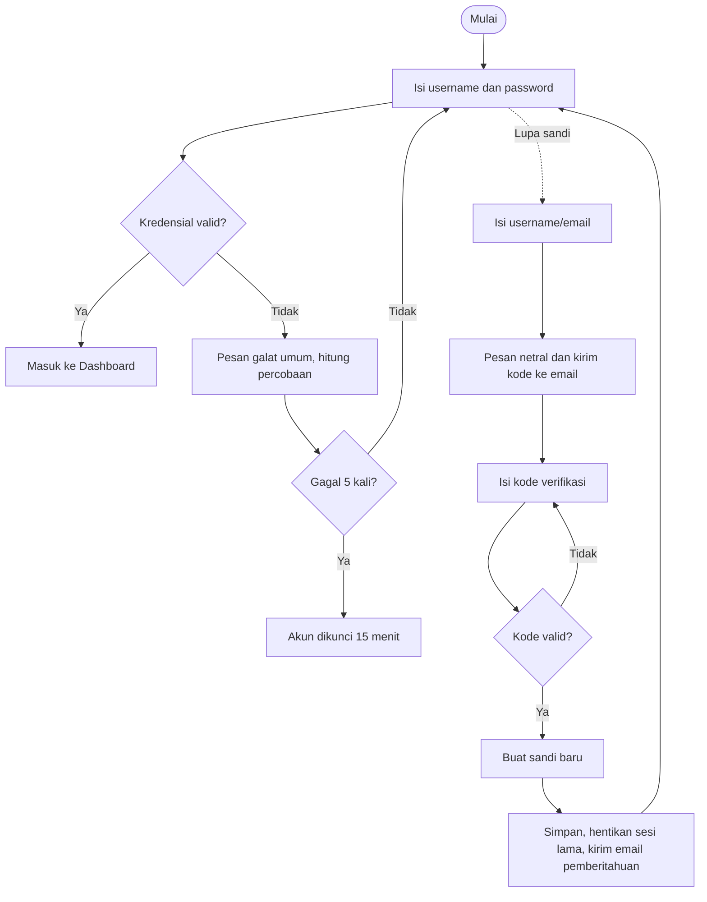
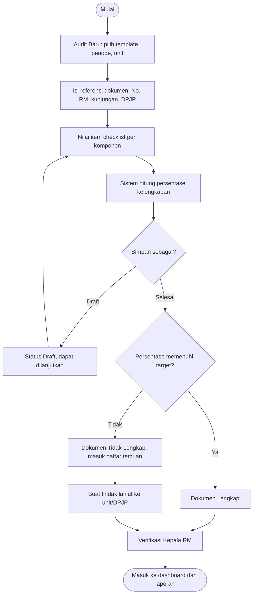
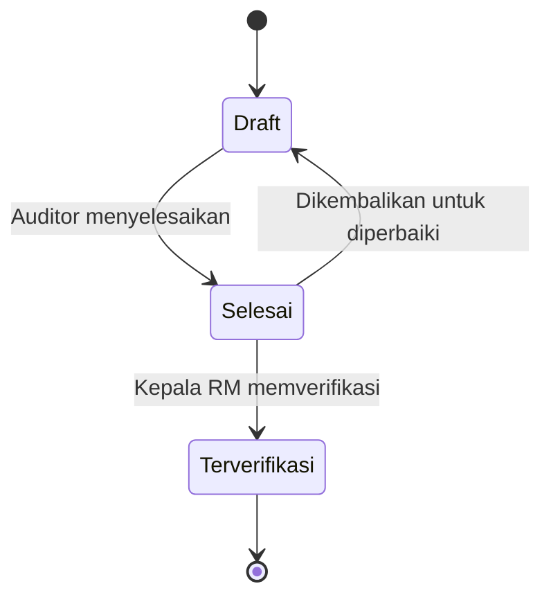
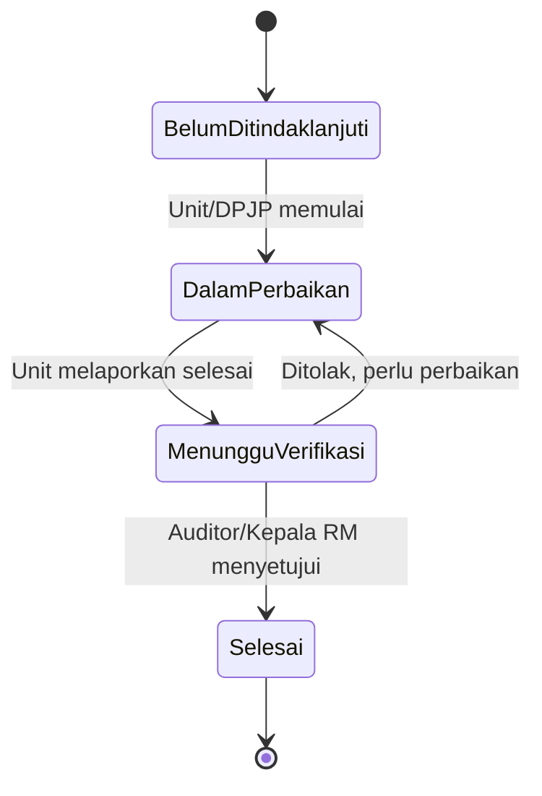
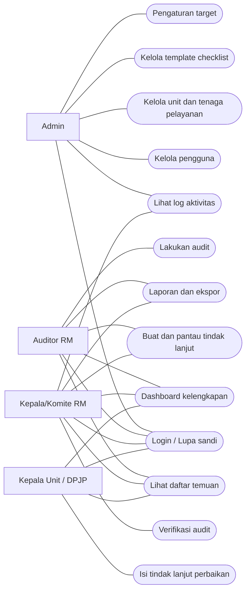
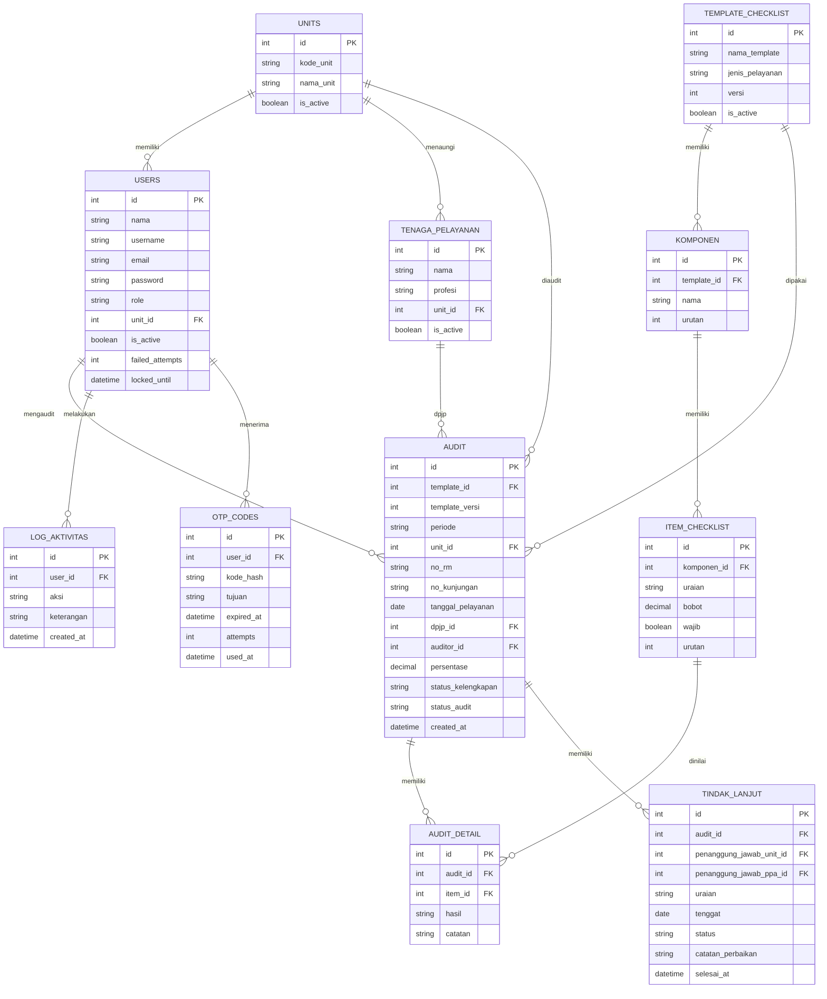

# PRODUCT REQUIREMENTS DOCUMENT (PRD)

## e-Mediqua: Aplikasi Audit Kelengkapan Rekam Medis Elektronik Berbasis Web untuk Mendukung Peningkatan Mutu dan Kepatuhan Pengisian Dokumen Rekam Medis

| Atribut | Keterangan |
|---|---|
| Nama Produk | **e-Mediqua** |
| Mata Kuliah | Pemrograman Web 2 |
| Program Studi | D4 Manajemen Informasi Kesehatan |
| Penyusun | *[Nama Mahasiswa / NIM]* |
| Dosen Pengampu | *[Nama Dosen]* |
| Versi Dokumen | 1.0 (Draft Lengkap) |
| Tanggal | 22 Oktober 2026 |
| Status | Draft untuk review |

## Riwayat Revisi

| Versi | Tanggal | Perubahan | Penyusun |
|---|---|---|---|
| 1.0 | 22 Okt 2026 | Penyusunan PRD lengkap | *[Nama]* |

## Daftar Isi

- [1. Ringkasan Produk](#1-ringkasan-produk)
- [2. Latar Belakang dan Permasalahan](#2-latar-belakang-dan-permasalahan)
- [3. Tujuan Produk dan Indikator Keberhasilan](#3-tujuan-produk-dan-indikator-keberhasilan)
- [4. Ruang Lingkup](#4-ruang-lingkup)
- [5. Stakeholder dan Pengguna](#5-stakeholder-dan-pengguna)
- [6. User Stories](#6-user-stories)
- [7. Alur Bisnis dan Diagram](#7-alur-bisnis-dan-diagram)
- [8. Metodologi Audit dan Rumus Perhitungan](#8-metodologi-audit-dan-rumus-perhitungan)
- [9. Aturan Bisnis](#9-aturan-bisnis)
- [10. Kebutuhan Fungsional](#10-kebutuhan-fungsional)
- [11. Spesifikasi Form dan Validasi](#11-spesifikasi-form-dan-validasi)
- [12. Kebutuhan Non-Fungsional](#12-kebutuhan-non-fungsional)
- [13. Hak Akses Berdasarkan Peran](#13-hak-akses-berdasarkan-peran)
- [14. Rancangan Data](#14-rancangan-data)
- [15. Rancangan Antarmuka (UI)](#15-rancangan-antarmuka-ui)
- [16. Spesifikasi Dashboard dan Laporan](#16-spesifikasi-dashboard-dan-laporan)
- [17. Rancangan Rute dan Endpoint Aplikasi](#17-rancangan-rute-dan-endpoint-aplikasi)
- [18. Arsitektur dan Rancangan Teknologi](#18-arsitektur-dan-rancangan-teknologi)
- [19. Keamanan dan Kepatuhan Data](#19-keamanan-dan-kepatuhan-data)
- [20. Rencana Pengujian](#20-rencana-pengujian)
- [21. Kriteria Penerimaan](#21-kriteria-penerimaan)
- [22. Rencana Rilis dan Timeline](#22-rencana-rilis-dan-timeline)
- [23. Risiko dan Mitigasi](#23-risiko-dan-mitigasi)
- [24. Asumsi, Ketergantungan, dan Batasan](#24-asumsi-ketergantungan-dan-batasan)
- [25. Pertanyaan Terbuka](#25-pertanyaan-terbuka)
- [26. Pengembangan Lanjutan](#26-pengembangan-lanjutan)
- [27. Glosarium](#27-glosarium)
- [28. Daftar Pustaka](#28-daftar-pustaka)
- [29. Persetujuan Dokumen](#29-persetujuan-dokumen)

---

## 1. Ringkasan Produk

**e-Mediqua** adalah aplikasi berbasis web yang dapat diakses secara online untuk membantu petugas rekam medis melakukan **audit kelengkapan dokumen rekam medis elektronik (RME)** secara sistematis. Auditor memilih template checklist, menilai setiap komponen dokumen (identitas pasien, anamnesis, pemeriksaan, diagnosis, tindakan, autentikasi, dan komponen lain sesuai standar yang digunakan), lalu sistem menghitung **persentase kelengkapan** secara otomatis.

Sistem menyajikan **laporan hasil audit berdasarkan periode, unit pelayanan, komponen, dan tenaga pelayanan**, serta membantu mengidentifikasi dokumen yang belum lengkap beserta tindak lanjut perbaikannya. Dengan demikian evaluasi mutu rekam medis dan kepatuhan pengisian dokumen menjadi lebih cepat, konsisten, dan dapat dipertanggungjawabkan.

| Aspek | Keterangan |
|---|---|
| Jenis produk | Aplikasi web responsif (komputer, tablet, ponsel) |
| Pengguna utama | Auditor rekam medis, Kepala/Komite Rekam Medis, Kepala Unit/DPJP, Admin |
| Nilai utama | Audit terstandar, perhitungan otomatis, temuan terlacak sampai tuntas, laporan siap pakai |
| Pendekatan data | Hanya menyimpan referensi dokumen dan hasil checklist; **tidak menyimpan isi klinis RME** |

---

## 2. Latar Belakang dan Permasalahan

Audit kelengkapan rekam medis umumnya dilakukan secara manual menggunakan form kertas atau spreadsheet. Kondisi ini menimbulkan beberapa masalah:

| No | Masalah | Dampak |
|---|---|---|
| 1 | Format checklist berbeda-beda antar auditor/periode | Hasil audit tidak konsisten dan sulit dibandingkan |
| 2 | Perhitungan persentase dilakukan manual | Rawan salah hitung dan memakan waktu |
| 3 | Rekap per periode dan per unit dibuat manual | Laporan terlambat, sulit menemukan tren |
| 4 | Dokumen tidak lengkap sulit diidentifikasi kembali | Perbaikan lambat atau tidak dilakukan |
| 5 | Tidak ada pencatatan tindak lanjut yang terstruktur | Temuan sama berulang, kepatuhan tidak membaik |
| 6 | Data audit tersebar di banyak file | Sulit diaudit ulang dan dipertanggungjawabkan |

Kelengkapan pengisian rekam medis merupakan bagian dari mutu rekam medis dan menjadi perhatian dalam pengelolaan rekam medis (merujuk pada Permenkes No. 24 Tahun 2022 tentang Rekam Medis) serta dalam penilaian mutu dan akreditasi fasilitas. Diperlukan sistem audit yang terstandar, otomatis, dan menghasilkan data yang dapat dianalisis.

---

## 3. Tujuan Produk dan Indikator Keberhasilan

### 3.1 Tujuan Umum
Meningkatkan mutu dan kepatuhan pengisian dokumen rekam medis elektronik melalui audit kelengkapan yang sistematis, terukur, dan terdokumentasi.

### 3.2 Tujuan Khusus
1. Menyediakan checklist audit terstandar yang dapat disesuaikan per jenis pelayanan.
2. Menghitung persentase kelengkapan dokumen secara otomatis dan konsisten.
3. Menampilkan hasil audit per periode, unit pelayanan, komponen, dan tenaga pelayanan.
4. Mengidentifikasi dokumen dan komponen yang belum lengkap.
5. Mencatat dan memantau tindak lanjut perbaikan sampai selesai.
6. Menghasilkan laporan audit yang dapat diekspor untuk evaluasi mutu.

### 3.3 Indikator Keberhasilan (Success Metrics)

| Metrik | Target | Cara Pengukuran |
|---|---|---|
| Waktu audit satu dokumen | ≤ 5 menit | Stopwatch saat UAT (rata-rata 10 dokumen) |
| Akurasi perhitungan persentase | 100% sama dengan hitung manual | Uji perbandingan dengan kasus uji (TC-10 s.d. TC-13) |
| Waktu pembuatan laporan periode | ≤ 1 menit | Uji pembuatan laporan bulanan pada saat UAT |
| Temuan yang memiliki tindak lanjut | ≥ 90% | Rasio temuan dengan tindak lanjut tercatat |
| Konsistensi penilaian antar auditor | Checklist sama untuk semua auditor | Seluruh audit memakai template aktif yang sama |
| Skor kepuasan pengguna | ≥ 80% | Kuesioner skala Likert saat UAT |

---

## 4. Ruang Lingkup

### 4.1 Dalam Lingkup (In Scope)
- Manajemen template checklist audit (komponen dan item) per jenis pelayanan.
- Pelaksanaan audit: memilih dokumen (referensi), menilai item, menyimpan hasil.
- Perhitungan otomatis persentase kelengkapan per dokumen.
- Penandaan dokumen Lengkap/Tidak Lengkap dan daftar temuan.
- Pencatatan dan pemantauan tindak lanjut perbaikan.
- Dashboard dan laporan berdasarkan periode, unit pelayanan, komponen, dan tenaga pelayanan.
- Ekspor laporan ke PDF dan Excel.
- Manajemen pengguna, hak akses, unit pelayanan, dan tenaga pelayanan.
- Login, lupa sandi, dan log aktivitas.

### 4.2 Di Luar Lingkup (Out of Scope)
- Penyimpanan atau penampilan isi klinis RME (anamnesis, diagnosis, dan sebagainya).
- Integrasi langsung dengan SIMRS/RME atau SATUSEHAT (pengembangan lanjutan).
- Audit kualitatif/kesesuaian isi klinis (hanya audit kelengkapan).
- Penilaian otomatis berbasis AI atau pembacaan isi dokumen.
- Aplikasi mobile native (cukup web responsif).

---

## 5. Stakeholder dan Pengguna

### 5.1 Stakeholder

| Stakeholder | Kepentingan | Keterlibatan |
|---|---|---|
| Mahasiswa (pengembang) | Menghasilkan aplikasi sesuai tugas mata kuliah | Merancang, membangun, menguji, mendokumentasikan |
| Dosen pengampu | Menilai kesesuaian rancangan dan hasil | Mereviu dan menyetujui PRD |
| Kepala/Komite Rekam Medis | Mutu rekam medis meningkat dan dapat dilaporkan | Pengguna laporan, verifikator audit |
| Auditor rekam medis | Audit lebih cepat, rapi, dan konsisten | Pengguna utama harian |
| Kepala unit dan tenaga pelayanan (DPJP/PPA) | Mengetahui temuan dan memperbaiki dokumen | Pelaksana tindak lanjut |

### 5.2 Peran Pengguna

| Peran | Deskripsi | Kebutuhan Utama |
|---|---|---|
| Admin Sistem | Mengelola sistem dan data master | Kelola pengguna, unit, tenaga pelayanan, template, pengaturan |
| Auditor Rekam Medis | Petugas yang melakukan audit | Mengisi checklist, melihat hasil, membuat laporan |
| Kepala/Komite RM | Penanggung jawab mutu rekam medis | Memverifikasi audit, memantau dashboard, mengunduh laporan |
| Kepala Unit / Tenaga Pelayanan | Pemilik dokumen yang diaudit | Melihat temuan unit/pribadi dan melaporkan perbaikan |

### 5.3 Persona

| Persona | Gambaran |
|---|---|
| **Ibu Rani, 32 tahun, Auditor RM** | Mengaudit puluhan dokumen RME tiap bulan memakai Excel. Sering salah hitung dan lama menyusun rekap. Ingin checklist baku dan persentase otomatis. |
| **Dr. Adi, 41 tahun, DPJP** | Ingin tahu komponen mana dari dokumen pasiennya yang sering belum lengkap agar bisa memperbaiki kebiasaan pengisian. |
| **Pak Hendra, 45 tahun, Kepala RM** | Harus melaporkan mutu kelengkapan RM tiap bulan. Ingin dashboard per unit dan tren dari periode ke periode. |

---

## 6. User Stories

| ID | Sebagai | Saya ingin | Agar | Prioritas |
|---|---|---|---|---|
| US-01 | Pengguna | login dengan akun pribadi | aktivitas saya tercatat atas nama saya | P1 |
| US-02 | Pengguna | memulihkan sandi lewat fitur lupa sandi | dapat masuk kembali tanpa menunggu Admin | P1 |
| US-03 | Admin | mengelola template checklist (komponen dan item) | audit sesuai standar yang dipakai fasilitas | P1 |
| US-04 | Admin | mengelola data unit dan tenaga pelayanan | audit dapat dikelompokkan per unit dan DPJP | P1 |
| US-05 | Auditor | memilih template dan mengisi referensi dokumen (No. RM, kunjungan, unit, DPJP) | audit tercatat rapi tanpa menyalin isi klinis | P1 |
| US-06 | Auditor | menilai tiap item Lengkap/Tidak Lengkap/Tidak Berlaku | penilaian seragam dan cepat | P1 |
| US-07 | Auditor | melihat persentase kelengkapan otomatis saat mengisi | tidak perlu menghitung manual | P1 |
| US-08 | Auditor | menyimpan audit sebagai draft lalu menyelesaikannya | dapat melanjutkan audit yang belum selesai | P1 |
| US-09 | Auditor | melihat daftar dokumen tidak lengkap beserta komponennya | temuan mudah diidentifikasi | P1 |
| US-10 | Auditor | membuat tindak lanjut untuk temuan | perbaikan dapat ditagih dan dipantau | P1 |
| US-11 | Kepala RM | melihat dashboard persentase kelengkapan per unit dan periode | memantau mutu secara cepat | P1 |
| US-12 | Kepala RM | memverifikasi hasil audit | hasil resmi dan tidak berubah | P2 |
| US-13 | Kepala RM | mengunduh laporan PDF/Excel | menjadi bahan rapat mutu dan akreditasi | P2 |
| US-14 | Kepala Unit / DPJP | melihat temuan unit/pribadi dan mengisi tindak lanjut | dapat memperbaiki dokumen tepat waktu | P1 |
| US-15 | Kepala RM | membandingkan kelengkapan antar periode | tren perbaikan terlihat | P2 |
| US-16 | Admin | mengatur target kelengkapan dan ambang warna | sesuai kebijakan fasilitas | P2 |
| US-17 | Admin | melihat log aktivitas | dapat mengaudit perubahan data | P2 |
| US-18 | Auditor | mengimpor daftar kunjungan dari CSV/Excel untuk sampel audit | tidak perlu input referensi satu per satu | P3 |

---

## 7. Alur Bisnis dan Diagram

### 7.1 Login dan Lupa Sandi
1. Pengguna mengisi username dan password pada halaman Login.
2. Jika benar, pengguna masuk ke Dashboard sesuai peran. Jika salah 5 kali berturut-turut, akun dikunci sementara 15 menit.
3. **Lupa sandi:** pengguna memilih "Lupa sandi?", mengisi username/email, sistem mengirim kode verifikasi (OTP) atau tautan pemulihan ke email terdaftar dengan pesan netral (tidak membocorkan apakah akun ada).
4. Pengguna memasukkan kode, lalu membuat sandi baru. Sesi lama dihentikan dan email pemberitahuan dikirim.



### 7.2 Alur Audit Kelengkapan
1. Auditor membuka menu **Audit Baru**.
2. Auditor memilih jenis pelayanan/template, periode, unit pelayanan, dan mengisi referensi dokumen (No. RM, No. kunjungan, tanggal pelayanan, DPJP).
3. Sistem menampilkan checklist per komponen. Auditor menilai setiap item: **Lengkap**, **Tidak Lengkap**, atau **Tidak Berlaku**; item tidak lengkap dapat diberi catatan.
4. Sistem menghitung persentase kelengkapan secara langsung.
5. Auditor menyimpan sebagai **Draft** atau menyelesaikannya (**Selesai**). Dokumen dengan persentase kurang dari target ditandai **Tidak Lengkap** dan masuk daftar temuan.
6. Auditor/Kepala RM membuat **tindak lanjut** untuk temuan. Kepala RM memverifikasi hasil audit (**Terverifikasi**).



### 7.3 Siklus Status

**Status audit:**



**Status tindak lanjut temuan:**



### 7.4 Diagram Use Case



---

## 8. Metodologi Audit dan Rumus Perhitungan

### 8.1 Komponen Checklist Bawaan (Contoh)

Template bawaan disusun berdasarkan komponen utama dokumen rekam medis. **Item dan bobot bersifat contoh dan dapat diubah Admin agar sesuai standar yang digunakan fasilitas.**

| Komponen | Contoh Item yang Dinilai |
|---|---|
| A. Identitas Pasien | Nama lengkap; nomor RM; tanggal lahir/umur; jenis kelamin; alamat; cara bayar/penjamin |
| B. Anamnesis | Keluhan utama; riwayat penyakit sekarang; riwayat penyakit dahulu; riwayat alergi; riwayat pengobatan |
| C. Pemeriksaan | Tanda-tanda vital; pemeriksaan fisik; pemeriksaan penunjang (bila ada) |
| D. Diagnosis | Diagnosis utama; diagnosis sekunder (bila ada); kode diagnosis |
| E. Tindakan dan Terapi | Rencana terapi/tindakan; tindakan yang dilakukan (bila ada); pemberian obat/resep; edukasi pasien |
| F. Persetujuan | Persetujuan tindakan/informed consent (bila ada tindakan) |
| G. Autentikasi | Nama dan autentikasi tenaga pelayanan; tanggal dan jam pengisian; verifikasi DPJP |
| H. Lainnya | Resume medis (rawat inap); ketepatan waktu pengisian sesuai kebijakan fasilitas |

### 8.2 Nilai Penilaian per Item

| Nilai | Arti | Masuk Perhitungan? |
|---|---|---|
| Lengkap | Item terisi sesuai ketentuan | Ya (pembilang dan penyebut) |
| Tidak Lengkap | Item kosong atau tidak sesuai ketentuan | Ya (hanya penyebut) |
| Tidak Berlaku (N/A) | Item tidak relevan untuk kasus tersebut | Tidak (dikeluarkan) |

### 8.3 Rumus

**Persentase kelengkapan dokumen** (dengan bobot item, bobot bawaan = 1):

```text
Kelengkapan dokumen (%) =  Σ bobot item Lengkap
                           ---------------------------------------  × 100
                           Σ bobot item dinilai (Lengkap + Tidak Lengkap)
```

**Persentase kelengkapan per komponen**: rumus yang sama, dihitung hanya untuk item dalam komponen tersebut.

**Ringkasan unit/periode:**

```text
Rata-rata kelengkapan (%)    = rata-rata persentase kelengkapan seluruh dokumen yang diaudit
Dokumen lengkap (%)         = jumlah dokumen berstatus Lengkap / jumlah dokumen diaudit × 100
```

### 8.4 Status Dokumen dan Kategori Warna

| Kondisi | Status/Warna (nilai awal, dapat diatur Admin) |
|---|---|
| Kelengkapan = target (nilai awal 100%) | **Lengkap** (hijau) |
| 80% ≤ kelengkapan < target | **Tidak Lengkap** (kuning) |
| Kelengkapan < 80% | **Tidak Lengkap** (merah) |

### 8.5 Contoh Perhitungan

Dokumen dengan 20 item: 17 Lengkap, 1 Tidak Lengkap, 2 Tidak Berlaku.

| Komponen | Lengkap | Tidak Lengkap | N/A | Persentase |
|---|:---:|:---:|:---:|:---:|
| Identitas Pasien | 6 | 0 | 0 | 100% |
| Anamnesis | 4 | 1 | 0 | 80% |
| Pemeriksaan | 3 | 0 | 0 | 100% |
| Diagnosis | 2 | 0 | 1 | 100% |
| Tindakan dan Terapi | 2 | 0 | 1 | 100% |
| **Total dokumen** | **17** | **1** | **2** | **17 / 18 = 94,44%** |

Karena 94,44% < 100%, dokumen berstatus **Tidak Lengkap** dan masuk daftar temuan dengan komponen bermasalah: Anamnesis.

### 8.6 Pengambilan Sampel
- Jumlah dokumen yang diaudit per periode ditentukan kebijakan fasilitas (misalnya jumlah tetap atau persentase dari kunjungan).
- Aplikasi menyimpan **jumlah sampel** dan **periode** audit agar laporan dapat menunjukkan cakupan audit.
- Pemilihan sampel secara acak dilakukan di luar aplikasi pada versi awal; impor daftar sampel tersedia sebagai fitur P3.

---

## 9. Aturan Bisnis

| ID | Aturan |
|---|---|
| BR-01 | Setiap audit wajib memakai satu template checklist aktif dan seluruh item wajib dinilai sebelum audit berstatus Selesai. |
| BR-02 | Nilai item hanya: Lengkap, Tidak Lengkap, atau Tidak Berlaku. |
| BR-03 | Item Tidak Berlaku dikeluarkan dari penghitungan persentase. |
| BR-04 | Item berstatus Tidak Lengkap wajib diberi catatan singkat. |
| BR-05 | Persentase kelengkapan dihitung otomatis oleh sistem dan tidak dapat diubah manual. |
| BR-06 | Dokumen berstatus Lengkap jika persentase mencapai target (nilai awal 100%); selain itu Tidak Lengkap. |
| BR-07 | Audit berstatus Draft dapat diubah oleh pembuatnya. Audit Selesai tidak dapat diubah; hanya dapat dikembalikan ke Draft oleh Kepala RM atau diperbaiki Admin dengan alasan dan tercatat di log. |
| BR-08 | Perubahan template tidak memengaruhi audit lama. Template memiliki versi, dan setiap audit menyimpan versi template yang dipakai. |
| BR-09 | Dokumen yang sama (kombinasi No. RM + No. kunjungan + template) tidak boleh diaudit dua kali pada periode yang sama; sistem memberi peringatan. |
| BR-10 | Setiap temuan (dokumen Tidak Lengkap) dapat memiliki satu atau lebih tindak lanjut dengan penanggung jawab dan tenggat. |
| BR-11 | Kepala Unit/DPJP hanya dapat melihat temuan unit atau dokumennya sendiri. |
| BR-12 | Aplikasi tidak menyimpan isi klinis RME. Yang disimpan hanya referensi dokumen dan hasil penilaian. Nama pasien tidak disimpan. |
| BR-13 | Data master (unit, tenaga pelayanan, template, pengguna) yang sudah dipakai transaksi tidak dihapus permanen, hanya dinonaktifkan. |
| BR-14 | Login: akun dikunci 15 menit setelah 5 kali gagal berturut-turut. Sesi berakhir otomatis setelah 30 menit tidak aktif. |
| BR-15 | Lupa sandi: respons sistem selalu sama baik akun ada maupun tidak; kode berlaku 5 menit, sekali pakai, maksimal 3 kali salah. |
| BR-16 | Sandi baru minimal 8 karakter, memuat huruf dan angka, tidak sama dengan sandi lama; setelah berubah semua sesi lama dihentikan. |
| BR-17 | Kepala RM bersifat verifikator dan tidak mengubah isi penilaian audit. |
| BR-18 | Laporan hanya memuat data audit berstatus Selesai atau Terverifikasi (Draft tidak dihitung). |

---

## 10. Kebutuhan Fungsional

Prioritas: **P1** = wajib (MVP), **P2** = penting, **P3** = opsional.

### 10.1 Autentikasi dan Pengguna
| ID | Kebutuhan | Prioritas |
|---|---|---|
| FR-01 | Login dengan username dan password; logout | P1 |
| FR-02 | Pembatasan percobaan login dan penguncian akun sementara | P1 |
| FR-03 | Lupa sandi: permintaan, verifikasi kode ke email, pembuatan sandi baru | P1 |
| FR-04 | Pemberitahuan email setelah sandi berubah dan penghentian sesi lama | P2 |
| FR-05 | Ubah password sendiri dari menu profil | P2 |
| FR-06 | Admin mengelola akun (tambah, ubah, nonaktifkan, reset sandi) | P1 |
| FR-07 | Hak akses berdasarkan peran | P1 |
| FR-08 | Verifikasi OTP saat login (login dua langkah) | P3 |

### 10.2 Data Master
| ID | Kebutuhan | Prioritas |
|---|---|---|
| FR-09 | Kelola unit pelayanan | P1 |
| FR-10 | Kelola tenaga pelayanan (DPJP/PPA): nama, profesi, unit | P1 |
| FR-11 | Kelola template checklist: nama, jenis pelayanan, versi, status aktif | P1 |
| FR-12 | Kelola komponen dan item checklist (urutan, bobot, wajib) | P1 |
| FR-13 | Duplikasi template menjadi versi baru | P2 |
| FR-14 | Pengaturan target kelengkapan dan ambang warna | P2 |

### 10.3 Pelaksanaan Audit
| ID | Kebutuhan | Prioritas |
|---|---|---|
| FR-15 | Membuat audit baru: pilih template, periode, unit, isi referensi dokumen | P1 |
| FR-16 | Menilai item per komponen (Lengkap, Tidak Lengkap, Tidak Berlaku) | P1 |
| FR-17 | Persentase kelengkapan dokumen dan per komponen tampil otomatis saat menilai | P1 |
| FR-18 | Catatan wajib untuk item Tidak Lengkap | P1 |
| FR-19 | Simpan sebagai Draft dan lanjutkan kemudian | P1 |
| FR-20 | Selesaikan audit; sistem menetapkan status Lengkap/Tidak Lengkap | P1 |
| FR-21 | Peringatan jika dokumen yang sama sudah diaudit pada periode yang sama | P2 |
| FR-22 | Daftar audit dengan pencarian, filter (periode, unit, status, auditor), dan paginasi | P1 |
| FR-23 | Verifikasi audit oleh Kepala RM atau mengembalikan ke Draft dengan alasan | P2 |
| FR-24 | Impor daftar kunjungan/sampel dari CSV/Excel | P3 |

### 10.4 Temuan dan Tindak Lanjut
| ID | Kebutuhan | Prioritas |
|---|---|---|
| FR-25 | Daftar dokumen tidak lengkap beserta komponen/item yang belum lengkap | P1 |
| FR-26 | Membuat tindak lanjut: penanggung jawab (unit/DPJP), uraian, tenggat | P1 |
| FR-27 | Kepala Unit/DPJP memperbarui status dan melaporkan perbaikan | P1 |
| FR-28 | Verifikasi penyelesaian tindak lanjut oleh Auditor/Kepala RM | P2 |
| FR-29 | Penanda tindak lanjut melewati tenggat | P2 |

### 10.5 Dashboard dan Laporan
| ID | Kebutuhan | Prioritas |
|---|---|---|
| FR-30 | Dashboard: rata-rata kelengkapan, % dokumen lengkap, jumlah audit, jumlah temuan, tren per bulan | P1 |
| FR-31 | Laporan per periode | P1 |
| FR-32 | Laporan per unit pelayanan | P1 |
| FR-33 | Laporan per komponen (komponen yang paling sering tidak lengkap) | P2 |
| FR-34 | Laporan per tenaga pelayanan (DPJP/PPA) | P2 |
| FR-35 | Laporan perbandingan antar periode | P2 |
| FR-36 | Laporan status tindak lanjut | P2 |
| FR-37 | Ekspor laporan ke PDF dan Excel | P2 |
| FR-38 | Log aktivitas pengguna (audit trail) | P2 |

---

## 11. Spesifikasi Form dan Validasi

### 11.1 Form Login
| Field | Tipe | Wajib | Aturan |
|---|---|:---:|---|
| username | Teks | Ya | Maksimal 50 karakter |
| password | Password | Ya | Minimal 8 karakter; 5 kali gagal mengunci akun 15 menit |

### 11.2 Form Lupa Sandi dan Sandi Baru
| Field | Tipe | Wajib | Aturan |
|---|---|:---:|---|
| username_atau_email | Teks | Ya | Respons selalu sama baik akun ada maupun tidak |
| kode_verifikasi | Angka 6 digit | Ya | Berlaku 5 menit, sekali pakai, maksimal 3 kali salah |
| sandi_baru | Password | Ya | Minimal 8 karakter, huruf dan angka, tidak sama dengan sandi lama |
| konfirmasi_sandi | Password | Ya | Harus sama dengan sandi_baru |

### 11.3 Form Template Checklist
| Field | Tipe | Wajib | Aturan |
|---|---|:---:|---|
| nama_template | Teks | Ya | Unik per versi; maksimal 100 karakter |
| jenis_pelayanan | Pilihan | Ya | Rawat Jalan, Rawat Inap, IGD, Lainnya |
| komponen.nama | Teks | Ya | Maksimal 100 karakter |
| komponen.urutan | Angka | Ya | Bilangan bulat positif, tidak boleh ganda dalam satu template |
| item.uraian | Teks | Ya | Maksimal 255 karakter |
| item.bobot | Angka | Ya | Lebih dari 0; nilai awal 1 |
| item.wajib | Pilihan | Ya | Ya / Tidak |

### 11.4 Form Audit Baru
| Field | Tipe | Wajib | Aturan |
|---|---|:---:|---|
| template_id | Pilihan | Ya | Hanya template aktif |
| periode | Bulan-Tahun | Ya | Tidak boleh di masa depan |
| unit_id | Pilihan | Ya | Unit aktif |
| no_rm | Teks | Ya | Angka dan tanda hubung; maksimal 20 karakter |
| no_kunjungan | Teks | Ya | Maksimal 30 karakter |
| tanggal_pelayanan | Tanggal | Ya | Tidak boleh di masa depan |
| dpjp_id | Pilihan | Ya | Tenaga pelayanan aktif |
| hasil item | Radio | Ya | Lengkap / Tidak Lengkap / Tidak Berlaku |
| catatan item | Teks | Kondisional | Wajib jika item Tidak Lengkap; maksimal 255 karakter |

### 11.5 Form Tindak Lanjut
| Field | Tipe | Wajib | Aturan |
|---|---|:---:|---|
| audit_id | Referensi | Ya | Audit berstatus Selesai/Terverifikasi dan Tidak Lengkap |
| penanggung_jawab | Pilihan | Ya | Unit atau tenaga pelayanan aktif |
| uraian | Teks panjang | Ya | Maksimal 500 karakter |
| tenggat | Tanggal | Ya | Tidak boleh sebelum hari ini |
| bukti/catatan perbaikan | Teks | Kondisional | Wajib saat dilaporkan selesai |

### 11.6 Form Unit, Tenaga Pelayanan, dan Pengguna
| Field | Tipe | Wajib | Aturan |
|---|---|:---:|---|
| kode_unit / nama_unit | Teks | Ya | Kode unik; nama maksimal 100 karakter |
| nama tenaga pelayanan | Teks | Ya | Maksimal 100 karakter |
| profesi | Pilihan | Ya | Dokter, Perawat, Bidan, Lainnya |
| username | Teks | Ya | Unik; maksimal 50 karakter |
| email | Email | Ya | Format valid dan unik (untuk pemulihan sandi) |
| role | Pilihan | Ya | admin, auditor, kepala_rm, kepala_unit |
| unit_id | Pilihan | Kondisional | Wajib untuk role kepala_unit |

### 11.7 Pesan Kesalahan dan Penanganan

| Kondisi | Pesan/Perilaku |
|---|---|
| Username/password salah | "Username atau password salah." |
| Akun terkunci | "Terlalu banyak percobaan. Coba lagi setelah 15 menit." |
| Kode verifikasi salah/kedaluwarsa | "Kode salah atau sudah kedaluwarsa." dengan opsi kirim ulang |
| Item belum dinilai saat menyelesaikan audit | "Masih ada item yang belum dinilai." Item ditandai |
| Item Tidak Lengkap tanpa catatan | "Catatan wajib diisi untuk item tidak lengkap." |
| Dokumen sudah pernah diaudit di periode sama | Peringatan dengan tautan ke audit sebelumnya |
| Mengubah audit yang sudah Selesai | "Audit sudah selesai dan tidak dapat diubah." |
| Akses tanpa izin | Halaman 403 |
| Sesi habis | Diarahkan ke login |
| Kegagalan penyimpanan/email | Pesan umum; kejadian dicatat di log server |

---

## 12. Kebutuhan Non-Fungsional

| Kategori | Kebutuhan |
|---|---|
| Keamanan | Password di-hash; proteksi SQL Injection, XSS, CSRF; HTTPS; sesi dengan batas waktu |
| Privasi | Tidak menyimpan isi klinis RME dan nama pasien; hanya referensi dan hasil checklist |
| Kinerja | Halaman dimuat ≤ 3 detik; penyimpanan audit ≤ 2 detik; ekspor 1.000 baris ≤ 10 detik |
| Ketersediaan | Dapat diakses online 24/7 (target uptime ≥ 99%) |
| Kompatibilitas | Responsif; Chrome, Edge, Firefox, Safari versi terbaru |
| Usability | Form audit dapat diisi dengan keyboard dan layar sentuh; bahasa Indonesia; progres pengisian terlihat |
| Akurasi | Perhitungan persentase konsisten dan teruji (lihat bab 20) |
| Auditabilitas | Setiap perubahan mencatat pengguna dan waktu; versi template tersimpan per audit |
| Skalabilitas | Mampu menyimpan puluhan ribu audit dan ratusan ribu detail penilaian |
| Backup | Pencadangan basis data berkala (minimal harian) |
| Pemeliharaan | Kode terstruktur (MVC), terdokumentasi, dikelola dengan Git |

---

## 13. Hak Akses Berdasarkan Peran

| Fitur | Admin | Auditor | Kepala RM | Kepala Unit/DPJP |
|---|:---:|:---:|:---:|:---:|
| Login, lupa sandi, ubah sandi sendiri | Penuh | Penuh | Penuh | Penuh |
| Kelola pengguna | Penuh | - | - | - |
| Kelola unit dan tenaga pelayanan | Penuh | - | - | - |
| Kelola template checklist | Penuh | Lihat | Lihat | - |
| Pengaturan target dan ambang | Penuh | - | - | - |
| Membuat dan mengisi audit | Penuh | Penuh | - | - |
| Verifikasi audit | - | - | Penuh | - |
| Lihat daftar temuan | Penuh | Penuh | Penuh | Terbatas |
| Buat tindak lanjut | Penuh | Penuh | Penuh | - |
| Isi/lapor tindak lanjut | - | - | - | Penuh (miliknya) |
| Dashboard | Penuh | Penuh | Penuh | Terbatas |
| Laporan dan ekspor | Penuh | Penuh | Penuh | Terbatas |
| Log aktivitas | Penuh | - | Lihat | - |

*Keterangan: Penuh = akses penuh; Lihat = hanya melihat; Terbatas = hanya data unit/miliknya; "-" = tidak ada akses.*

---

## 14. Rancangan Data

### 14.1 Entity Relationship Diagram (ERD)



### 14.2 Kamus Data Utama

**Tabel `audit`**

| Field | Tipe | Keterangan |
|---|---|---|
| id | INT (PK) | Identitas audit |
| template_id, template_versi | INT | Template dan versinya saat audit dibuat |
| periode | CHAR(7) | Format `YYYY-MM` |
| unit_id | INT (FK) | Unit pelayanan yang diaudit |
| no_rm | VARCHAR(20) | Referensi nomor RM (bukan nama pasien) |
| no_kunjungan | VARCHAR(30) | Referensi kunjungan/episode |
| tanggal_pelayanan | DATE | Tanggal pelayanan |
| dpjp_id | INT (FK) | Tenaga pelayanan penanggung jawab dokumen |
| auditor_id | INT (FK users) | Auditor pelaksana |
| persentase | DECIMAL(5,2) | Hasil perhitungan otomatis |
| status_kelengkapan | ENUM | lengkap, tidak_lengkap |
| status_audit | ENUM | draft, selesai, terverifikasi |
| created_at, updated_at | DATETIME | Waktu pencatatan |

**Tabel `audit_detail`**

| Field | Tipe | Keterangan |
|---|---|---|
| audit_id, item_id | INT (FK) | Kombinasi unik per audit dan item |
| hasil | ENUM | lengkap, tidak_lengkap, tidak_berlaku |
| catatan | VARCHAR(255) | Wajib jika tidak_lengkap |

**Tabel `tindak_lanjut`**

| Field | Tipe | Keterangan |
|---|---|---|
| audit_id | INT (FK) | Temuan terkait |
| penanggung_jawab_unit_id / penanggung_jawab_ppa_id | INT (FK, nullable) | Penanggung jawab (unit dan/atau tenaga pelayanan) |
| uraian | VARCHAR(500) | Tindakan perbaikan yang diminta |
| tenggat | DATE | Batas waktu |
| status | ENUM | belum, dalam_perbaikan, menunggu_verifikasi, selesai |
| catatan_perbaikan | VARCHAR(500) | Bukti/ringkasan perbaikan |
| selesai_at | DATETIME (nullable) | Waktu selesai |

**Tabel pendukung:** `users`, `units`, `tenaga_pelayanan`, `template_checklist`, `komponen`, `item_checklist`, `log_aktivitas`, `otp_codes`, `pengaturan` (target kelengkapan, ambang warna) sesuai ERD di atas.

### 14.3 Constraint dan Indeks
- Unique: `users.username`, `users.email`, `units.kode_unit`, (`audit_id`, `item_id`) pada `audit_detail`.
- Foreign key dengan aturan RESTRICT saat hapus; data master dinonaktifkan, bukan dihapus.
- Indeks: `audit(periode, unit_id)`, `audit(status_audit)`, `audit(no_rm, no_kunjungan)`, `tindak_lanjut(status, tenggat)` untuk mempercepat laporan dan pencarian.
- Persentase disimpan pada `audit` saat audit diselesaikan (snapshot) agar laporan lama tidak berubah bila template diubah.
- Pembersihan `otp_codes` yang kedaluwarsa dilakukan terjadwal.

---

## 15. Rancangan Antarmuka (UI)

### 15.1 Prinsip Desain
- Fokus pada tugas utama: **Audit Baru** dapat dicapai maksimal 2 klik dari Dashboard.
- Form checklist dikelompokkan per komponen (accordion/tab) dengan indikator progres dan persentase langsung.
- Warna konsisten: hijau (lengkap), kuning (mendekati), merah (kurang), abu-abu (tidak berlaku).
- Responsif dan ramah layar sentuh; bahasa Indonesia.

### 15.2 Daftar Halaman (Sitemap)

| No | Halaman | Pengguna |
|---|---|---|
| 1 | Login, Lupa Sandi, Sandi Baru | Semua |
| 2 | Dashboard | Semua (sesuai peran) |
| 3 | Daftar Audit | Admin, Auditor, Kepala RM |
| 4 | Form Audit (baru/ubah/detail) | Admin, Auditor |
| 5 | Daftar Temuan | Admin, Auditor, Kepala RM, Kepala Unit |
| 6 | Tindak Lanjut (daftar/detail) | Admin, Auditor, Kepala RM, Kepala Unit |
| 7 | Verifikasi Audit | Kepala RM |
| 8 | Laporan (periode, unit, komponen, DPJP, tindak lanjut) | Admin, Auditor, Kepala RM, Kepala Unit (terbatas) |
| 9 | Template Checklist (komponen dan item) | Admin |
| 10 | Data Unit | Admin |
| 11 | Data Tenaga Pelayanan | Admin |
| 12 | Manajemen Pengguna | Admin |
| 13 | Pengaturan (target, ambang warna) | Admin |
| 14 | Profil / Ubah Sandi | Semua |
| 15 | Log Aktivitas | Admin, Kepala RM |

### 15.3 Wireframe (Sketsa Teks)

*Sketsa awal; tampilan akhir dapat berbeda tanpa mengubah fungsi. Data hanya contoh fiktif.*

**Login**

```text
+--------------------------------------------------------------+
| e-Mediqua                                                    |
+--------------------------------------------------------------+
|              +--------------------------------+              |
|              |        Masuk ke e-Mediqua      |              |
|              |  Audit Kelengkapan Rekam Medis |              |
|              |  Username                      |              |
|              |  [____________________________]|              |
|              |  Password                      |              |
|              |  [****************************]|              |
|              |                   Lupa sandi?  |              |
|              |  [            MASUK          ] |              |
|              +--------------------------------+              |
+--------------------------------------------------------------+
```

**Dashboard**

```text
+--------------------------------------------------------------------------+
| e-Mediqua                     Periode: [Okt 2026 v]  Ibu Rani (Auditor)  |
+----------------+---------------------------------------------------------+
| > Dashboard    | +-----------+ +-----------+ +-----------+ +-----------+ |
|   Audit        | |Rata-rata  | |Dokumen    | |Jumlah     | |Temuan     | |
|   Temuan       | |Kelengkapan| |Lengkap    | |Audit      | |Terbuka    | |
|   Tindak Lanjut| |  91,8%    | |  72%      | |  120      | |  34       | |
|   Laporan      | +-----------+ +-----------+ +-----------+ +-----------+ |
|   Template     | Tren kelengkapan 6 bulan  | Kelengkapan per unit        |
|   Master Data  | 100|        ___---        | Poli Anak    ######## 95%   |
|   Pengaturan   |  90|   __---              | IGD          ######   82%   |
|   Log          |  80|--                    | Rawat Inap   #######  88%   |
+----------------+---------------------------------------------------------+
```

**Form Audit**

```text
+--------------------------------------------------------------------------+
| Audit Baru                                              Status: DRAFT    |
+--------------------------------------------------------------------------+
| Template: [Rawat Jalan v]  Periode: [2026-10]  Unit: [Poli Anak v]       |
| No. RM: [00-12-34]  No. Kunjungan: [K-2210-001]  DPJP: [dr. Adi v]       |
+--------------------------------------------------------------------------+
| Progres: 12/20 item     KELENGKAPAN SAAT INI: 91,67%                      |
+--------------------------------------------------------------------------+
| [v] A. Identitas Pasien (6/6)                                  100%      |
| [v] B. Anamnesis (4/5)                                          80%      |
|     Keluhan utama .............. (o) Lengkap  ( ) Tidak  ( ) N/A         |
|     Riwayat alergi ............. ( ) Lengkap  (o) Tidak  ( ) N/A         |
|        Catatan: [belum diisi alergi_________________________]            |
| [>] C. Pemeriksaan   [>] D. Diagnosis   [>] E. Tindakan   [>] G. Autent. |
+--------------------------------------------------------------------------+
| [ SIMPAN DRAFT ]                                [ SELESAIKAN AUDIT ]     |
+--------------------------------------------------------------------------+
```

**Daftar Temuan dan Tindak Lanjut**

```text
+--------------------------------------------------------------------------+
| Daftar Temuan   [Periode v] [Unit v] [Status TL v]        [EKSPOR EXCEL] |
+--------------------------------------------------------------------------+
| No.RM     Unit        DPJP      %       Komponen Bermasalah   Status TL  |
| 00-12-34  Poli Anak   dr. Adi   94,4%   Anamnesis             Dalam perb.|
| 00-45-67  IGD         dr. Sinta 78,0%   Autentikasi, Diagnosis Belum     |
| 00-78-90  Rawat Inap  dr. Budi  85,7%   Resume Medis          Selesai    |
+--------------------------------------------------------------------------+
```

---

## 16. Spesifikasi Dashboard dan Laporan

### 16.1 Indikator Dashboard

| Indikator | Definisi |
|---|---|
| Rata-rata kelengkapan | Rata-rata persentase seluruh audit Selesai/Terverifikasi pada periode terpilih |
| Dokumen lengkap (%) | Dokumen berstatus Lengkap dibagi jumlah audit × 100 |
| Jumlah audit | Total audit Selesai/Terverifikasi |
| Temuan terbuka | Dokumen Tidak Lengkap dengan tindak lanjut belum Selesai |
| Tren | Rata-rata kelengkapan per bulan (grafik garis) |
| Kelengkapan per unit | Rata-rata per unit (grafik batang) |
| Komponen paling sering tidak lengkap | Peringkat komponen berdasarkan jumlah item Tidak Lengkap |

### 16.2 Daftar Laporan

| Laporan | Isi | Filter | Format |
|---|---|---|---|
| Per periode | Jumlah audit, rata-rata kelengkapan, % dokumen lengkap, daftar audit | Bulan/rentang tanggal, template | Tampilan, PDF, Excel |
| Per unit pelayanan | Ringkasan kelengkapan tiap unit | Periode, jenis pelayanan | Tampilan, PDF, Excel |
| Per komponen | Persentase kelengkapan tiap komponen, item paling sering kosong | Periode, unit | Tampilan, PDF, Excel |
| Per tenaga pelayanan | Kelengkapan dokumen tiap DPJP/PPA | Periode, unit | Tampilan, PDF, Excel |
| Dokumen tidak lengkap | Daftar temuan beserta komponen/item | Periode, unit, status | Tampilan, PDF, Excel |
| Perbandingan antar periode | Selisih kelengkapan dua periode | Dua periode, unit | Tampilan, PDF |
| Status tindak lanjut | Jumlah tindak lanjut belum/dalam perbaikan/selesai/terlambat | Periode, unit | Tampilan, PDF, Excel |

### 16.3 Ketentuan Laporan
- Hanya audit berstatus Selesai atau Terverifikasi yang dihitung.
- Header laporan memuat nama fasilitas (pengaturan), periode, filter yang dipakai, tanggal cetak, dan pembuat laporan.
- Laporan untuk Kepala Unit/DPJP otomatis dibatasi pada data miliknya.
- Nama pasien tidak tampil; hanya No. RM.

---

## 17. Rancangan Rute dan Endpoint Aplikasi

| Method | URL | Fungsi | Peran |
|---|---|---|---|
| GET/POST | /login | Form dan proses login | Publik |
| POST | /logout | Keluar | Semua |
| GET/POST | /lupa-sandi | Permintaan pemulihan sandi | Publik |
| POST | /lupa-sandi/verifikasi | Verifikasi kode | Publik |
| GET/POST | /reset-sandi | Form dan simpan sandi baru | Publik (berizin kode) |
| GET/PUT | /profil/ubah-sandi | Ubah sandi sendiri | Semua |
| GET | /dashboard | Dashboard | Semua |
| CRUD | /pengguna | Kelola pengguna | Admin |
| POST | /pengguna/{id}/reset-sandi | Reset sandi oleh Admin | Admin |
| CRUD | /unit | Kelola unit | Admin |
| CRUD | /tenaga-pelayanan | Kelola tenaga pelayanan | Admin |
| CRUD | /template | Kelola template | Admin |
| POST | /template/{id}/duplikat | Duplikasi template jadi versi baru | Admin |
| CRUD | /template/{id}/komponen | Kelola komponen | Admin |
| CRUD | /komponen/{id}/item | Kelola item checklist | Admin |
| GET | /audit | Daftar audit (filter) | Admin, Auditor, Kepala RM |
| GET | /audit/create | Form audit baru | Admin, Auditor |
| POST | /audit | Simpan audit (draft) | Admin, Auditor |
| GET | /audit/{id} | Detail audit | Sesuai hak akses |
| PUT | /audit/{id} | Ubah penilaian (draft) | Admin, Auditor |
| POST | /audit/{id}/selesai | Selesaikan audit | Admin, Auditor |
| POST | /audit/{id}/verifikasi | Verifikasi atau kembalikan ke draft | Kepala RM |
| GET | /temuan | Daftar temuan | Sesuai hak akses |
| CRUD | /tindak-lanjut | Kelola tindak lanjut | Auditor, Kepala RM; Kepala Unit (isi status) |
| GET | /laporan/{jenis} | Laporan (periode/unit/komponen/dpjp/tl) | Sesuai hak akses |
| GET | /laporan/{jenis}/export?format=pdf\|xlsx | Ekspor laporan | Sesuai hak akses |
| GET/PUT | /pengaturan | Target dan ambang warna | Admin |
| GET | /log | Log aktivitas | Admin, Kepala RM |
| GET | /api/audit/hitung | Hitung persentase sementara (JSON) untuk tampilan langsung | Auditor |

> Seluruh rute selain halaman publik dilindungi autentikasi dan pengecekan peran (middleware). Rute yang mengubah data dilindungi token CSRF.

---

## 18. Arsitektur dan Rancangan Teknologi

### 18.1 Arsitektur
Aplikasi menggunakan arsitektur client-server dengan pola MVC. Browser mengakses aplikasi lewat HTTPS; server menjalankan logika audit dan perhitungan, mengakses basis data, serta mengirim email.

| Lapisan | Tanggung Jawab | Komponen |
|---|---|---|
| Presentasi (View) | Form checklist, dashboard, grafik, laporan | Blade/HTML, CSS, JavaScript, Chart.js |
| Aplikasi (Controller/Service) | Aturan bisnis, perhitungan persentase, otorisasi, ekspor | Laravel Controller, Service class, Middleware, Form Request |
| Data (Model) | Akses dan penyimpanan data | Eloquent ORM, MySQL/MariaDB |

### 18.2 Teknologi yang Diusulkan

| Komponen | Usulan |
|---|---|
| Backend | PHP 8.x dengan Laravel (atau PHP Native pola MVC sesuai ketentuan mata kuliah) |
| Frontend | HTML, CSS, JavaScript, Bootstrap/Tailwind |
| Grafik | Chart.js |
| Basis Data | MySQL / MariaDB |
| Laporan | DomPDF (PDF) dan Laravel Excel (Excel) |
| Email | Laravel Mail dengan SMTP (mis. Mailtrap untuk pengujian) |
| Hosting | Hosting/VPS dengan HTTPS agar dapat diakses publik |
| Version Control | Git dan GitHub |

> Pilihan teknologi dapat disesuaikan dengan ketentuan dosen pengampu.

### 18.3 Lingkungan Pengembangan dan Deployment
- Lokal: XAMPP/Laragon, PHP 8.x, MySQL, Composer, Node.js (jika memakai Vite/Tailwind), VS Code.
- Pengujian: basis data terpisah dengan data dummy.
- Produksi: hosting HTTPS, file `.env` terpisah, mode debug dimatikan, SMTP dikonfigurasi.
- Deployment: unggah kode (Git/FTP), jalankan migrasi dan seeder (template bawaan), atur penjadwalan (cron) untuk pembersihan OTP.
- Backup: ekspor basis data berkala dan salinan kode di repositori Git.

---

## 19. Keamanan dan Kepatuhan Data

| Aspek | Penerapan |
|---|---|
| Autentikasi | Password ter-hash; pembatasan percobaan login; sesi 30 menit tidak aktif |
| Otorisasi | Middleware peran pada setiap rute; Kepala Unit hanya melihat data miliknya |
| Proteksi input | Validasi server; query terparameter (ORM); escape output (XSS) |
| CSRF | Token CSRF pada semua form |
| Transport | Seluruh akses melalui HTTPS |
| Minimisasi data | Tidak menyimpan isi klinis RME dan nama pasien; hanya referensi dan hasil checklist |
| Pemulihan sandi | Respons netral, kode sekali pakai dan berumur pendek, disimpan ter-hash |
| Integritas hasil | Audit Selesai tidak dapat diubah; perubahan oleh Admin tercatat dengan alasan |
| Audit trail | Log login, pembuatan/penyelesaian/verifikasi audit, perubahan template, dan pengaturan |
| Backup | Cadangan basis data berkala dan uji pemulihan |
| Data uji | Pada tahap tugas hanya data dummy; tidak ada data pasien asli |

Landasan regulasi acuan perancangan: Permenkes No. 24 Tahun 2022 tentang Rekam Medis, UU No. 17 Tahun 2023 tentang Kesehatan, dan UU No. 27 Tahun 2022 tentang Pelindungan Data Pribadi. Penggunaan nyata di fasilitas kesehatan perlu ditinjau bersama manajemen dan pengelola data fasilitas.

---

## 20. Rencana Pengujian

### 20.1 Jenis Pengujian

| Jenis | Tujuan |
|---|---|
| Fungsional (black-box) | Memastikan fitur berjalan sesuai kebutuhan dan aturan bisnis |
| Pengujian perhitungan | Memastikan persentase sama dengan hitung manual |
| Validasi form | Memastikan aturan validasi dan pesan kesalahan bekerja |
| Hak akses | Memastikan peran hanya mengakses fitur yang diizinkan |
| Keamanan dasar | SQL Injection sederhana, XSS, akses URL tanpa login |
| Kompatibilitas | Chrome, Edge, Firefox, dan ponsel |
| Kinerja ringan | Waktu muat halaman, simpan audit, ekspor laporan |
| UAT | Dicoba calon pengguna (simulasi auditor) dengan kuesioner kepuasan |

### 20.2 Contoh Kasus Uji

| ID | Skenario | Data/Langkah Uji | Hasil Diharapkan |
|---|---|---|---|
| TC-01 | Login benar | Username dan password valid | Masuk dashboard sesuai peran |
| TC-02 | Login salah 5 kali | Password salah berulang | Akun dikunci 15 menit |
| TC-03 | Lupa sandi akun terdaftar | Isi email, kode benar, sandi baru valid | Sandi berubah, sesi lama berakhir, email notifikasi terkirim |
| TC-04 | Lupa sandi akun tidak terdaftar | Isi email acak | Pesan netral sama seperti akun terdaftar |
| TC-05 | Buat template | Tambah komponen dan item | Template tersimpan dengan versi 1 |
| TC-06 | Ubah template yang sudah dipakai | Duplikasi menjadi versi 2 | Audit lama tetap memakai versi lama |
| TC-07 | Audit baru valid | Isi referensi dan seluruh item | Audit tersimpan; persentase tampil |
| TC-08 | Item tidak lengkap tanpa catatan | Pilih Tidak Lengkap, catatan kosong | Ditolak; catatan wajib |
| TC-09 | Selesaikan audit dengan item belum dinilai | Sisakan satu item | Ditolak; item ditandai |
| TC-10 | Perhitungan semua lengkap | 20 item Lengkap | 100%, status Lengkap |
| TC-11 | Perhitungan dengan N/A | 17 Lengkap, 1 Tidak, 2 N/A | 94,44%, status Tidak Lengkap |
| TC-12 | Perhitungan berbobot | Item bobot 2 Lengkap, bobot 1 Tidak | 66,67% |
| TC-13 | Semua N/A | Seluruh item N/A | Ditolak/peringatan; tidak ada item yang dinilai |
| TC-14 | Audit ganda | No. RM + kunjungan + template sama di periode sama | Peringatan duplikat |
| TC-15 | Ubah audit selesai | Edit audit berstatus Selesai | Ditolak |
| TC-16 | Verifikasi audit | Kepala RM memverifikasi | Status Terverifikasi |
| TC-17 | Tindak lanjut | Buat tindak lanjut, Kepala Unit lapor selesai, auditor setujui | Status berakhir Selesai |
| TC-18 | Batas data Kepala Unit | Kepala Unit membuka laporan | Hanya data unit/miliknya |
| TC-19 | Laporan per unit | Pilih periode dan ekspor PDF/Excel | File sesuai filter dan angka cocok dengan dashboard |
| TC-20 | Akses tanpa hak | Auditor membuka /pengguna | Halaman 403 |
| TC-21 | Akses tanpa login | Buka /dashboard tanpa login | Diarahkan ke login |

---

## 21. Kriteria Penerimaan

| ID | Skenario | Kriteria Diterima |
|---|---|---|
| AC-01 | Auditor memilih template dan mengisi referensi dokumen | Checklist tampil lengkap per komponen sesuai template |
| AC-02 | Auditor menilai item | Persentase dokumen dan per komponen berubah otomatis dan benar |
| AC-03 | Item Tidak Berlaku dipilih | Item dikeluarkan dari perhitungan |
| AC-04 | Audit diselesaikan dengan persentase di bawah target | Dokumen berstatus Tidak Lengkap dan muncul di Daftar Temuan |
| AC-05 | Audit berstatus Selesai dibuka kembali untuk diubah | Perubahan ditolak |
| AC-06 | Template diubah setelah dipakai audit | Audit lama tidak berubah |
| AC-07 | Tindak lanjut dibuat untuk temuan | Kepala Unit/DPJP terkait dapat melihat dan memperbarui status |
| AC-08 | Dashboard dibuka untuk satu periode | Rata-rata kelengkapan, % dokumen lengkap, jumlah audit, temuan terbuka, tren, dan grafik per unit tampil sesuai data |
| AC-09 | Laporan per periode/unit/komponen diekspor | File PDF/Excel terunduh sesuai filter dan angka sama dengan layar |
| AC-10 | Kepala Unit/DPJP login | Hanya data unit atau dokumennya yang tampil |
| AC-11 | Pengguna lupa sandi | Dapat membuat sandi baru melalui kode email, respons netral untuk akun tak terdaftar |
| AC-12 | Aplikasi dibuka dari ponsel | Tampilan menyesuaikan layar dan form audit dapat diisi |

---

## 22. Rencana Rilis dan Timeline

### 22.1 Cakupan Rilis

| Rilis | Isi | Kebutuhan |
|---|---|---|
| MVP (Rilis 1) | Login, lupa sandi, data master, template checklist, audit dan perhitungan otomatis, daftar temuan, tindak lanjut dasar, dashboard dasar, laporan per periode dan per unit | Kebutuhan P1 |
| Rilis 2 | Verifikasi audit, laporan komponen/DPJP/perbandingan/tindak lanjut, ekspor PDF/Excel, pengaturan target, log aktivitas, ubah sandi, email notifikasi | Kebutuhan P2 |
| Rilis 3 (opsional) | Impor sampel kunjungan, login dengan OTP | Kebutuhan P3 |

### 22.2 Timeline Usulan

| Tahap | Aktivitas | Estimasi |
|---|---|---|
| 1 | Analisis kebutuhan dan penyusunan PRD | Minggu 1 |
| 2 | Perancangan sistem (ERD, wireframe/mockup) | Minggu 2 |
| 3 | Autentikasi, lupa sandi, dan data master | Minggu 3–4 |
| 4 | Template checklist dan modul audit beserta perhitungan | Minggu 5–7 |
| 5 | Temuan, tindak lanjut, dashboard, dan laporan | Minggu 8–9 |
| 6 | Pengujian (fungsional, perhitungan, UAT) dan perbaikan | Minggu 10–11 |
| 7 | Deployment online dan dokumentasi | Minggu 12 |

### 22.3 Luaran (Deliverables)
- Dokumen PRD (dokumen ini).
- Rancangan sistem: ERD dan wireframe/mockup.
- Kode sumber di repositori Git.
- Aplikasi yang dapat diakses online (URL publik).
- Template checklist bawaan (seeder) dan data uji dummy.
- Laporan pengujian dan hasil UAT.
- Buku panduan pengguna singkat dan presentasi/demo.

---

## 23. Risiko dan Mitigasi

| Risiko | Dampak | Mitigasi |
|---|---|---|
| Standar/komponen checklist berbeda antar fasilitas | Template tidak sesuai | Template dapat diatur Admin dan berversi; sediakan template bawaan sebagai contoh |
| Auditor menilai secara subjektif | Hasil tidak konsisten | Item dengan uraian jelas dan panduan penilaian per item; checklist seragam |
| Kesalahan rumus persentase | Laporan tidak akurat | Kasus uji perhitungan (TC-10 s.d. TC-13), perhitungan di satu service terpusat |
| Kebocoran data | Pelanggaran privasi | Tidak menyimpan isi klinis dan nama pasien; hak akses ketat; HTTPS; log |
| Pengguna enggan memakai | Adopsi rendah | Antarmuka sederhana, panduan singkat, pelatihan |
| Tidak ada integrasi dengan RME | Input referensi manual | Impor CSV (P3); integrasi dirancang sebagai pengembangan lanjutan |
| Email pemulihan sandi tidak sampai | Pengguna terkunci | Konfigurasi SMTP andal, opsi kirim ulang, reset oleh Admin |
| Waktu pengembangan terbatas | Fitur tidak selesai | Prioritaskan MVP (P1), P2/P3 sebagai tambahan |
| Hosting bermasalah | Aplikasi tidak dapat diakses | Backup berkala, hosting dengan dukungan stabil |

---

## 24. Asumsi, Ketergantungan, dan Batasan

### 24.1 Asumsi
- Auditor memiliki akses terhadap dokumen RME di sistem fasilitas dan menilai kelengkapan di luar aplikasi ini.
- Standar checklist mengikuti kebijakan fasilitas; template bawaan hanya contoh.
- Setiap pengguna memiliki email aktif untuk pemulihan sandi.
- Pada tahap tugas digunakan data dummy.

### 24.2 Ketergantungan
- Layanan hosting, domain, dan sertifikat HTTPS.
- Layanan email (SMTP) untuk pemulihan sandi.
- Library pihak ketiga (Chart.js, PDF/Excel exporter).

### 24.3 Batasan
- Aplikasi hanya audit **kelengkapan** (ada/tidaknya isian), bukan kebenaran atau kualitas isi klinis.
- Aplikasi tidak membaca isi RME secara otomatis; penilaian dilakukan oleh auditor.
- Tidak terintegrasi dengan sistem lain pada versi awal.

---

## 25. Pertanyaan Terbuka

| No | Pertanyaan | Penanggung Jawab | Status |
|---|---|---|---|
| 1 | Standar/pedoman checklist apa yang dijadikan acuan (akreditasi, kebijakan RS/klinik)? | Dosen / Kepala RM | Terbuka |
| 2 | Apakah target kelengkapan 100% dan batas waktu pengisian (misalnya 24 jam setelah pelayanan) dipakai? | Dosen / Kepala RM | Terbuka |
| 3 | Apakah perlu pembobotan item atau semua item bobot sama? | Dosen | Terbuka |
| 4 | Jenis pelayanan apa saja yang dicakup (rawat jalan, rawat inap, IGD)? | Dosen / Kepala RM | Terbuka |
| 5 | Berapa jumlah sampel audit per periode dan siapa yang menentukan? | Kepala RM | Terbuka |
| 6 | Apakah Kepala Unit/DPJP perlu mengakses aplikasi, atau cukup laporan dari Auditor? | Dosen | Terbuka |
| 7 | Framework apa yang diwajibkan atau diperbolehkan pada mata kuliah ini? | Dosen | Terbuka |
| 8 | Apakah OTP saat login diperlukan atau cukup lupa sandi lewat email? | Dosen | Terbuka |

---

## 26. Pengembangan Lanjutan

- Integrasi dengan RME/SIMRS atau SATUSEHAT untuk pengambilan daftar kunjungan dan pengecekan kelengkapan otomatis.
- Audit kualitatif (kesesuaian isi) sebagai modul tambahan.
- Notifikasi tindak lanjut melalui email/WhatsApp.
- Login dengan OTP/autentikasi dua langkah.
- Pemilihan sampel acak otomatis.
- Analitik lanjutan (tren per DPJP, prediksi kepatuhan, benchmark antar unit).
- Mode offline (Progressive Web App).

---

## 27. Glosarium

| Istilah | Arti |
|---|---|
| RME | Rekam Medis Elektronik |
| Audit kelengkapan | Penilaian ada/tidaknya isian pada komponen dokumen rekam medis |
| Checklist | Daftar item yang dinilai pada audit |
| Komponen | Kelompok item (misalnya Identitas Pasien, Anamnesis) |
| DPJP | Dokter Penanggung Jawab Pelayanan |
| PPA | Profesional Pemberi Asuhan |
| Autentikasi (dokumen) | Pengesahan isian oleh tenaga pelayanan (nama, tanda tangan/elektronik, waktu) |
| Temuan | Dokumen berstatus Tidak Lengkap hasil audit |
| Tindak lanjut | Tindakan perbaikan atas temuan audit |
| N/A | Tidak Berlaku |
| OTP | One-Time Password, kode sekali pakai |
| UAT | User Acceptance Testing |
| MVP | Minimum Viable Product |
| ERD | Entity Relationship Diagram |
| MVC | Model-View-Controller |
| PRD | Product Requirements Document |

---

## 28. Daftar Pustaka

1. Peraturan Menteri Kesehatan Republik Indonesia Nomor 24 Tahun 2022 tentang Rekam Medis.
2. Undang-Undang Republik Indonesia Nomor 17 Tahun 2023 tentang Kesehatan.
3. Undang-Undang Republik Indonesia Nomor 27 Tahun 2022 tentang Pelindungan Data Pribadi.
4. Standar akreditasi dan pedoman mutu fasilitas pelayanan kesehatan yang berlaku pada fasilitas terkait (disesuaikan dengan standar yang digunakan).
5. OWASP Foundation. OWASP Top 10 Web Application Security Risks. https://owasp.org/www-project-top-ten/
6. OWASP Cheat Sheet Series: Forgot Password Cheat Sheet. https://cheatsheetseries.owasp.org/cheatsheets/Forgot_Password_Cheat_Sheet.html
7. Laravel Documentation. https://laravel.com/docs
8. Chart.js Documentation. https://www.chartjs.org/docs/

> Sesuaikan penulisan daftar pustaka dengan format sitasi yang diminta program studi dan lengkapi nomor peraturan standar akreditasi yang dipakai.

---

## 29. Persetujuan Dokumen

| Peran | Nama | Tanda Tangan | Tanggal |
|---|---|---|---|
| Penyusun | | | |
| Dosen Pengampu | | | |
